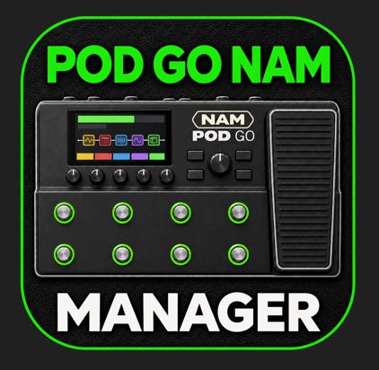
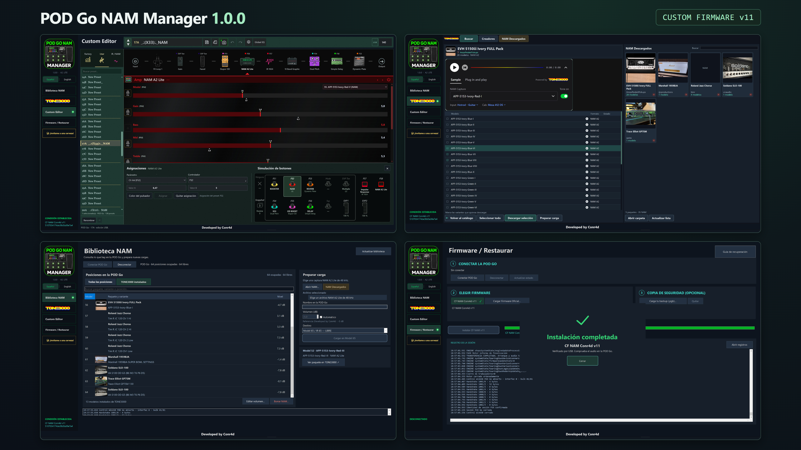

# POD Go NAM Manager 1.0.0 · Custom Firmware 11

**Español** · [English](README.md)

Gestiona capturas NAM A2 Lite y presets de la POD Go desde Windows. Una sola aplicación reúne **Biblioteca NAM**, **TONE3000**, **Custom Editor** y **Firmware / Restaurar**. El audio NAM se procesa en la pedalera.

[Release v1.0.0](https://github.com/conr4d86/POD-Go-NAM-Manager/releases/tag/v1.0.0) · [Notas de la versión](docs/RELEASE_NOTES_1.0.0.md) · [Inicio rápido](docs/INICIO_RAPIDO.md)

## Antes de conectar

Esta edición está dirigida a la **POD Go estándar**. Crea una copia completa `.pgb` con el editor oficial y guárdala fuera de la carpeta del Manager. Cierra POD Go Edit antes de conectar el Manager. Si utilizas **Clarity** en tus presets, conserva el backup original. El CF utiliza esa posición del catálogo para el bloque NAM A2 Lite.

## Primera instalación

1. Conecta la POD Go por USB y abre **Firmware / Restaurar**.
2. Comprueba que está seleccionado **CF 11**. Pulsa **Instalar** y revisa la confirmación. Mantén USB y alimentación conectados hasta que el Manager verifique el arranque.
3. Conserva el `.pgb` original para recuperar tus datos. La restauración PGB se inicia desde el editor.

Si tu POD Go ya tiene un CF, comprueba qué versión detecta el Manager. Conserva el PGB también para una actualización de firmware.

## Biblioteca NAM y TONE3000

Abre una captura NAM A2 Lite de 48 kHz o selecciónala en **NAM Descargados**. Elige una posición Model y espera a que el envío se verifique. Model 0 está integrado y es de solo lectura. Los 128 espacios restantes se comparten con los IR.

En **TONE3000**, usa los filtros de equipo, creadores y formato. En la fila de un paquete, abre **Variante ▾** para elegir una captura. Pulsa **▶** para escucharla o usa **Preparar carga** en el desplegable para descargar esa captura. En **NAM Descargados**, las tarjetas agrupan los modelos por paquete. [Powered by TONE3000](https://www.tone3000.com/)

## Custom Editor y recuperación

Edita el preset activo, la cadena de bloques, los snapshots y las asignaciones. En el banco **User**, busca la acción **Create New Preset** en el menú contextual para colocar una plantilla vacía en la posición elegida.

Para volver al firmware oficial, usa **Firmware / Restaurar** con el HXF oficial correspondiente y conserva el PGB original para recuperar tus datos. Si la pedalera queda en pantalla de actualización, sigue el procedimiento oficial indicado en la [guía de recuperación](docs/RECOVERY.md).

## Código y créditos

Desarrollado por **Conr4d / conr4daudio**, autor también de la captura NAM integrada. El kernel y las herramientas NAM derivan de [nocaseguy/hx-stomp-nam-lite](https://github.com/nocaseguy/hx-stomp-nam-lite). Consulta [LICENSE](LICENSE), [NOTICE](NOTICE) y el [aviso de la captura](models/NOTICE.txt).

## Apoya el proyecto

[☕ Invítame a un café](https://buymeacoffee.com/conr4d) · [Demostración en vídeo](https://youtu.be/cQ0YdaQXmy8) · [Versiones anteriores](https://github.com/conr4d86/POD-Go-NAM-Manager/releases)
