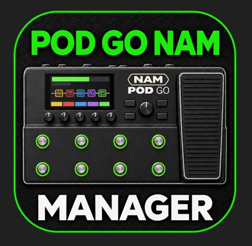
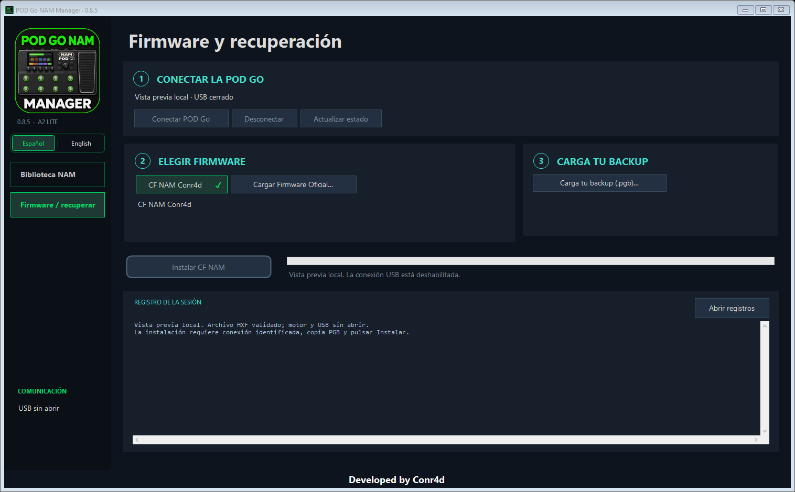
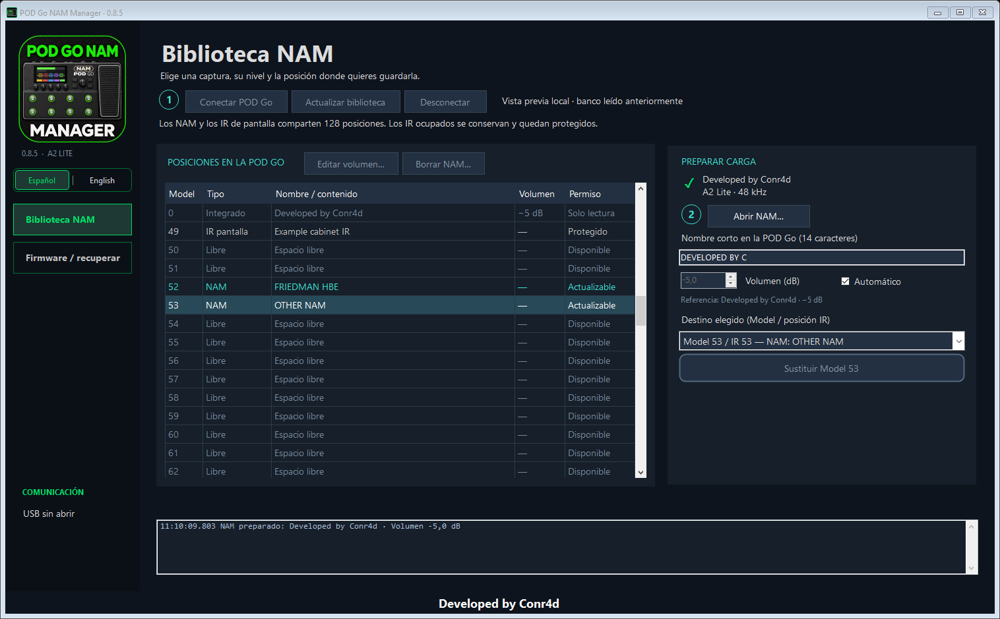

# POD Go NAM Manager

**Español** · [English](README.md)

Ejecuta **NAM A2 Lite dentro de tu POD Go** y cambia de captura por USB sin
reinstalar el firmware cada vez. Una aplicación Windows reúne **Firmware y
recuperación** y **Biblioteca NAM**, con interfaz en español e inglés.

El estado de las comprobaciones está en [validación](docs/VALIDATION.md).

[Descargar para Windows — 0.8.5](https://github.com/conr4d86/POD-Go-NAM-Manager/releases/download/v0.8.5/PODGoNamManager.exe)

¿Ya tienes el custom v8? Descarga el nuevo EXE y usa **Biblioteca NAM**.
Esta actualización no requiere reinstalar el firmware.

## Primera instalación

Antes, crea un backup con **POD Go Edit** y conserva el `.pgb`. Instala el driver
oficial de POD Go y cierra las aplicaciones Line 6.
El **CF NAM Conr4d viene incluido**: no necesitas aportar un HXF para instalarlo.

La app abre en **Firmware y recuperación**:

1. **Conectar POD Go**, encendida normalmente.
2. Elegir **CF NAM Conr4d** (incluido) y **Carga tu backup (.pgb)…**.
3. Pulsar **Instalar CF NAM**, leer el aviso del backup y confirmar **OK**.

Espera al resultado final y al arranque normal antes de comprobar el audio.
La instalación completa tarda bastante más que enviar un NAM.
Abrir la app no inicia una instalación ni abre automáticamente el USB.

**¿Cuánto tarda?** Según los reportes de usuarios, la espera puede aumentar con
la cantidad de IR guardados en la POD Go e incluidos en su backup. Un usuario ha
comunicado **5–10 minutos** para completar la instalación; es una referencia,
no un plazo garantizado. Mantén la pedalera conectada y espera al resultado final.

Guía completa: [Inicio rápido](docs/INICIO_RAPIDO.md) · [Preguntas frecuentes](docs/FAQ.md#español).

*Vista previa local de la interfaz; el estado de las pruebas físicas se indica abajo.*

## Cambiar de NAM: tres acciones

Con el custom instalado y la biblioteca conectada:

1. **Abrir NAM…** — elige tu captura.
2. **Elegir posición Model** — la app distingue libres, NAM e IR protegidos.
3. **Cargar en Model…** — espera a la verificación de la transferencia.

Selecciona ese Model en el bloque NAM A2 Lite de la pedalera. Después puedes
desconectar el ordenador: el audio se procesa dentro de la POD Go.

El campo **Nombre corto** permite mostrar, por ejemplo, `53. FRIEDMAN HBE`.
Para añadir el nombre a un NAM cargado con una versión anterior, vuelve a
enviarlo. En una posición ocupada aparece **Sustituir Model…**; se pide
confirmación y se conserva una copia previa. Los IR de pantalla están protegidos.

Hay un único control **Volumen (dB)** con **Automático**. Automático ejecuta
una prueba breve en el PC y compara el volumen de la captura con **Developed
by Conr4d a −5 dB**. Ajusta el volumen conservando la saturación del modelo.
Desmárcalo para elegir tú el volumen. El archivo NAM original queda intacto.

Selecciona un NAM guardado y pulsa **Editar volumen…** para ajustarlo en su
mismo Model, o **Borrar NAM…** para liberar la posición. Ambas operaciones
guardan una copia y verifican el resultado. Model 0 y los IR están protegidos.
Al borrar, los presets que usaban ese Model dejarán de encontrar ese NAM.
La edición necesita los niveles guardados en este PC; si faltan, abre el NAM
original y vuelve a cargarlo.

La **0.8.5** mantiene el tamaño normal en pantallas grandes, reduce las
proporciones cuando falta espacio y permite maximizar. En ventanas muy pequeñas
se puede desplazar el contenido para mantener los controles legibles. Actualizar
el gestor **no requiere reinstalar** el custom v8 incluido.

## Modelos, posiciones y pantallas

| Elemento | Función |
| --- | --- |
| Model 0 | Integrado, solo lectura: `0. Dev by Conr4d`; NAM de **conr4daudio** |
| Model 1–128 | La posición IR del mismo número; NAM e IR comparten ese banco |
| Mando Model | Muestra número y nombre corto encima de **Model**; el título sigue siendo **Amp NAM A2 Lite** |
| Bloque Cab/IR | Independiente del NAM: se activa o desactiva como siempre |

El NAM sustituye **Line 6 Clarity**. Admite capturas **A2 Lite, 3 canales,
1.871 pesos y 48 kHz**, también dentro de un SlimmableContainer con ese submodelo.
Las otras arquitecturas se rechazan explicando el motivo.

El firmware oficial también permite almacenar los datos, pero **para sonar como
NAM hace falta el custom**. Una carga verificada confirma los datos guardados,
no la instalación del CF. Todavía no se distingue fiablemente oficial/custom
mediante la identificación USB.

Esta versión se dirige a la **POD Go estándar con base 2.50**. No se afirma
compatibilidad con Wireless ni con otros equipos. No incorpora la modificación
independiente de ruteo AMP OUT / cabinet.

## Restauración

Pulsa **Cargar Firmware Oficial…** y selecciona el HXF original POD Go 2.50.
Después, carga tu backup desde POD Go Edit para recuperar los presets anteriores,
incluidos los que habían usado el bloque NAM.

Si no arranca normalmente, utiliza el modo actualización documentado de POD Go
(mantener **PAGE >** al encender) y las herramientas oficiales de recuperación.
Esta guía no incluye ningún restablecimiento de fábrica.
Más detalles: [recuperación](docs/RECOVERY.md).

## Código y créditos

Desarrollado por **Conr4d / conr4daudio**. NAM incluido: **conr4daudio**.
La parte de kernel/portador NAM deriva de
[nocaseguy/hx-stomp-nam-lite](https://github.com/nocaseguy/hx-stomp-nam-lite),
revisión `2e801641df4a083c29ee13c5718c047d336ef692`.
Código GPL-3.0-or-later: [LICENSE](LICENSE) y [NOTICE](NOTICE).
El NAM incluido tiene su propio [aviso](models/NOTICE.txt).

La descarga contiene el **ejecutable 0.8.5**, con el CF NAM Conr4d y
el motor de instalación incluidos. El archivo oficial se pide únicamente
si eliges restaurar el firmware original.
Compilación y pruebas: [BUILDING](docs/BUILDING.md).

Proyecto independiente, no oficial y experimental, sin afiliación con Line 6 ni Yamaha.
