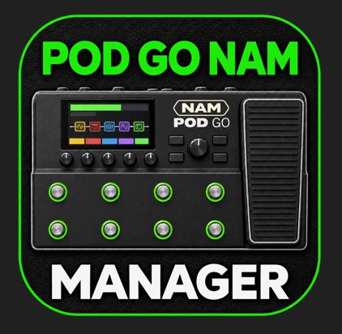
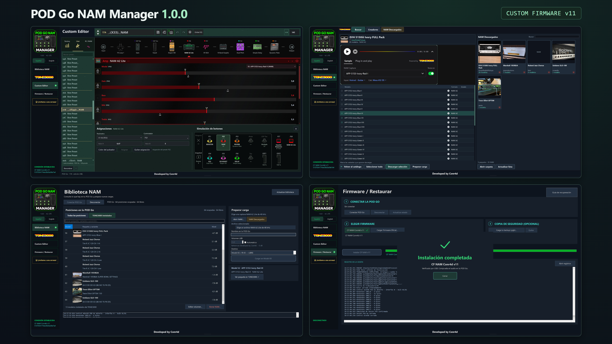

# POD Go NAM Manager 1.0.0 · Custom Firmware 11

**English** · [Español](README.es.md)

Manage NAM A2 Lite captures and POD Go presets from Windows. The app brings together the **NAM Library**, **TONE3000**, **Custom Editor**, and **Firmware / Restore**. NAM audio processing runs on the pedalboard.

[Release v1.0.0](https://github.com/conr4d86/POD-Go-NAM-Manager/releases/tag/v1.0.0) · [Release notes](docs/RELEASE_NOTES_1.0.0.md) · [Quick start](docs/QUICKSTART.md)

## Before connecting

This edition targets the **standard POD Go**. Create a full `.pgb` backup in the official editor and keep it outside the Manager folder. Close POD Go Edit before connecting from the Manager. If your presets use **Line 6 Clarity**, keep the original backup. The custom firmware uses that catalog position for the NAM A2 Lite block.

## First installation

1. Connect your POD Go over USB and open **Firmware / Restore**.
2. Check that **CF 11** is selected. Start the installation and review the confirmation. Keep USB and power connected until the Manager verifies the reboot.
3. Keep the original `.pgb` backup to recover your data. Start PGB restoration from the editor.

If custom firmware is already installed, check the version detected by the Manager. Keep the PGB handy when updating the firmware as well.

## NAM Library and TONE3000

Open a 48 kHz NAM A2 Lite capture or select one from **Downloaded NAMs**. Choose a Model position and wait for the transfer to be verified. Model 0 is built in and read-only. The other 128 positions are shared with IRs.

Use the gear, creator, and format filters in **TONE3000**. In a pack row, open **Variant ▾** to choose a capture. Click **▶** to hear it or use **Prepare upload** in the menu to download that capture. In **Downloaded NAMs**, cards group models by pack. [Powered by TONE3000](https://www.tone3000.com/)

## Custom Editor and recovery

Edit the active preset, signal chain, snapshots, and assignments. In the **User** bank, choose **Create New Preset** from a slot’s context menu to place an empty preset in the selected position.

To return to stock firmware, use **Firmware / Restore** with the matching official HXF and keep your original PGB to recover your data. If the pedalboard remains on its update screen, follow the official recovery procedure listed in the [recovery guide](docs/RECOVERY.md).

## Source and credits

Developed by **Conr4d / conr4daudio**, who also created the built-in NAM capture. The NAM kernel and tools come from [nocaseguy/hx-stomp-nam-lite](https://github.com/nocaseguy/hx-stomp-nam-lite). See [LICENSE](LICENSE), [NOTICE](NOTICE), and the [capture notice](models/NOTICE.txt). This project is independent of Line 6 and Yamaha.

## Support the project

[☕ Buy me a coffee](https://buymeacoffee.com/conr4d) · [Video demo](https://youtu.be/cQ0YdaQXmy8) · [Previous releases](https://github.com/conr4d86/POD-Go-NAM-Manager/releases)
