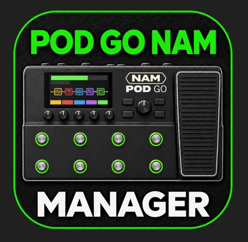
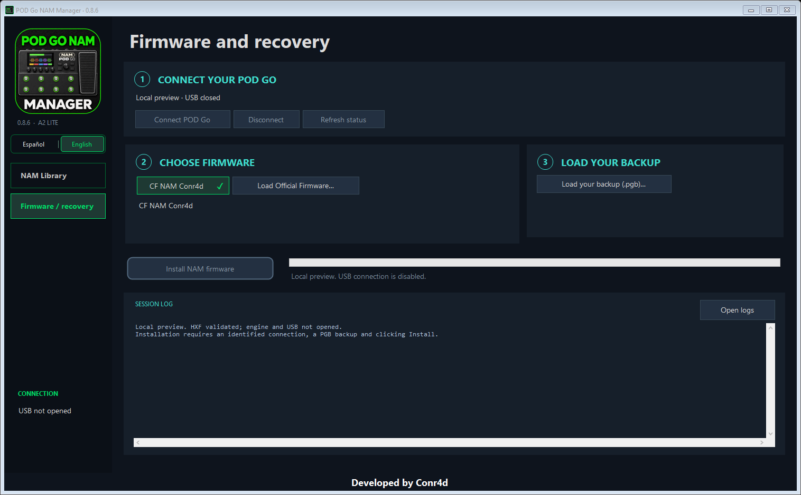
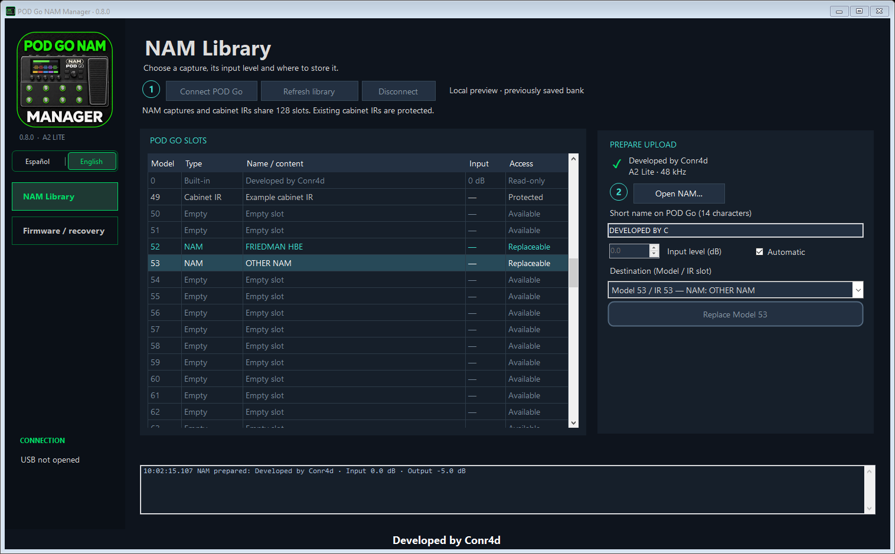

# POD Go NAM Manager

[Español](README.es.md) · **English**

Run **NAM A2 Lite inside your POD Go**, and change captures over USB without
reinstalling firmware for each model. One Windows app provides **Firmware and
recovery** and a **NAM Library**, with Spanish and English interfaces.

The test status is listed in [validation](docs/VALIDATION.md).

[Download for Windows — 0.8.6](https://github.com/conr4d86/POD-Go-NAM-Manager/releases/download/v0.8.6/PODGoNamManager.exe)

Already using custom v8? Download the new EXE and use **NAM Library**.
There is no firmware reinstall for this update.

**0.8.6 fixes intermittent “Incomplete response” errors** when editing NAM
volume or refreshing the library. Verified volume changes are retained even
if a later refresh fails. See the [release notes](docs/RELEASE_NOTES_0.8.6.md).

## Video demonstration

NAM A2 Lite running directly inside a Line 6 POD Go.

## First installation

Make a backup in **POD Go Edit** first and keep its `.pgb` file. Install the
official POD Go driver, then close POD Go Edit and other Line 6 applications.
The **CF NAM Conr4d is included**. You do not need an original HXF to install it.

Open Manager; it starts on **Firmware and recovery**:

1. **Connect POD Go** in normal startup mode.
2. Choose **CF NAM Conr4d** (included) and **Load your backup (.pgb)…**.
3. Click **Install NAM firmware**, read the backup reminder and confirm **OK**.

Wait for the final result and normal startup before checking audio. This is a
full firmware transfer and takes substantially longer than uploading a NAM.
There is no automatic installation when opening the app.

**How long does it take?** User reports suggest that the wait can increase with
the number of IRs stored on the POD Go and included in its backup. One user
reported completing installation in **5–10 minutes**; this is a reference,
not a guaranteed duration. Keep the pedalboard connected and wait for the final result.

Complete instructions: [Quick start](docs/QUICKSTART.md) · [FAQ](docs/FAQ.md#english).

*Offline interface preview; the current hardware-validation status is listed below.*

## Change a NAM in three actions

With custom firmware installed and the library connected:

1. **Open NAM…** — choose your capture.
2. **Choose a Model slot** — empty slots and existing NAMs are clearly marked.
3. **Upload to Model…** — wait for upload and full readback verification.

Select that Model in the NAM A2 Lite amp block on the pedalboard. You can then
disconnect the computer: the POD Go processes the audio itself.

Use the **short name** field for a Model value such as `53. FRIEDMAN HBE`. Existing
captures uploaded with older Manager versions need uploading again to add a
name. An occupied slot offers **Replace Model…**, followed by confirmation and a
verified backup. Cabinet IRs are protected.

There is one **Volume (dB)** control with **Automatic**. Automatic runs a short,
local test through the capture and compares its volume with **Developed by
Conr4d at −5 dB**. It adjusts volume while preserving the model's saturation.
Uncheck Automatic to set the volume yourself. The source NAM file stays unchanged.

Select a stored NAM and choose **Edit volume…** to update its volume in the
same Model, or **Delete NAM…** to free the slot. Both keep a backup and verify
the result. Model 0 and cabinet IRs are protected. Deleting a NAM means presets
using that Model will no longer find it. Volume editing needs the levels saved
on this PC; if unavailable, open the original NAM and upload it again.

Version **0.8.6** keeps its normal size on large screens, scales proportionally
when space is limited, and supports maximizing. Very small windows use scrolling
to keep controls readable. Updating Manager does **not** require reinstalling
the included v8 custom firmware.

## Models, slots and cabinets

| Item | Meaning |
| --- | --- |
| Model 0 | Built-in, read-only `0. Dev by Conr4d`; capture by **conr4daudio** |
| Model 1–128 | The corresponding user IR slot; NAMs and cabinet IRs share this bank |
| Model knob | Shows the number and short name above **Model**; the title stays **Amp NAM A2 Lite** |
| Cab/IR block | Separate from NAM; keep it enabled or bypass it as usual |

The amp model replaces **Line 6 Clarity**. Compatible captures are **A2 Lite,
3 channels, 1,871 weights, 48 kHz**, including a SlimmableContainer with that
submodel. Other NAM architectures are rejected with an explanation.

Uploading data is possible with official firmware, too; **NAM playback requires
custom firmware**. A successful upload confirms stored data, not an installed CF.
The app does not yet reliably identify official versus custom firmware over USB.

This port targets the **standard POD Go, base 2.50**. Wireless and other Line 6
models are not claimed as supported. Installing this firmware does not implement
the separate AMP OUT / cabinet routing modification.

## Recovery

Choose **Load Official Firmware…** and provide the exact original POD Go 2.50
HXF. After restoring it, load your backup in POD Go Edit to restore your previous
presets, including presets that had used the NAM block.

If normal startup fails, use the documented POD Go update mode (hold **PAGE >**
while powering on) and the official Line 6 recovery tools. Do not perform a
factory reset as part of this guide. See [recovery](docs/RECOVERY.md).

## Build and test

- Windows, .NET Framework 4.5+ and Python 3.10+ for source preparation.
- Build the CF first: `python tools/build_firmware.py path/to/original.hxf`.
- Then: `powershell -ExecutionPolicy Bypass -File .\build-windows.ps1`
- Audit without hardware: `powershell -ExecutionPolicy Bypass -File .\test-offline.ps1`
- These are developer steps; the downloadable EXE already includes the CF.

The download contains the 0.8.6 executable, with **CF NAM Conr4d and
the firmware engine included**. The original official HXF is requested only
when the user chooses to restore official firmware. Developer source builds
use locally installed engine files; see the build guide.
See [building](docs/BUILDING.md) for reproducibility and release packaging.

## Credits and licence

Developed by **Conr4d / conr4daudio**.
The included NAM is credited to **conr4daudio**.

The NAM carrier/kernel work derives from
[nocaseguy/hx-stomp-nam-lite](https://github.com/nocaseguy/hx-stomp-nam-lite),
pinned at `2e801641df4a083c29ee13c5718c047d336ef692`. Source, modifications and
licence notices are included. Code is **GPL-3.0-or-later**; see [NOTICE](NOTICE)
and [LICENSE](LICENSE). The included capture has its own [notice](models/NOTICE.txt).

Independent, unofficial and experimental. Not affiliated with Line 6 or Yamaha.

## Support the project

If POD Go NAM Manager is useful to you, you can support its development:

[☕ Buy me a coffee](https://buymeacoffee.com/conr4d)
